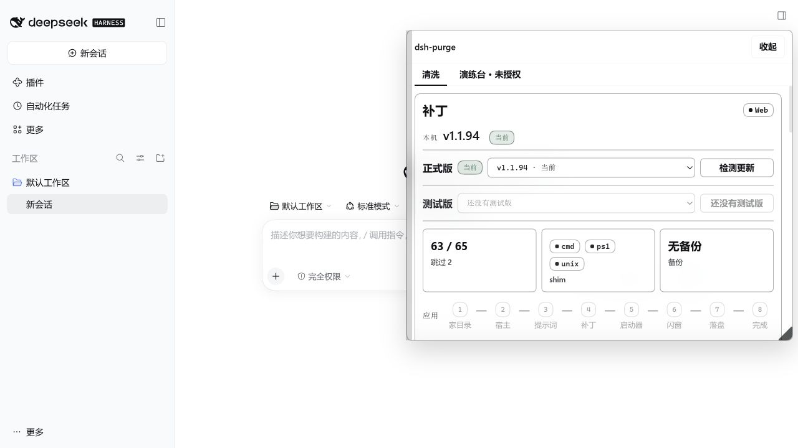

# dsh-purge 1.1.94：DSH 0.2.2-rc.1 适配记录

本版以 DSH **0.2.2-rc.1** 为主目标，保留 **0.2.1-rc.5 / rc.2** 的适配声明。不是只改 `dshTarget`：修改依据来自官方桌面 `app.asar`、npm 发布包和对应发布标签的源码。

验证日期：2026-11-13。npm 的 `latest` 为 `0.2.2-rc.1`，`next` 为 `0.2.2-rc.3`；后者未纳入本次验证。CLI / Web 需要 Node.js **24.9.0 或更新版本**，官方桌面端使用自带运行时。

## 上游依据

- [官方 0.2.2-rc.1 发布标签](https://github.com/deepseek-ai/deepseek-harness/releases/tag/dsh-v0.2.2-rc.1)
- [SystemPrompt 组装实现](https://github.com/deepseek-ai/deepseek-harness/blob/dsh-v0.2.2-rc.1/packages/core/system-prompt/src/index.ts)
- [工具包导出与拆分入口](https://github.com/deepseek-ai/deepseek-harness/blob/dsh-v0.2.2-rc.1/packages/core/tools/package.json)
- [官方 npm 包元数据](https://registry.npmjs.org/@deepseek-ai/dsh/0.2.2-rc.1)

上游标签提交为 `66491b05e3f05ad35bcdd4f6cd7ed26041d9e3db`。本机官方桌面归档的 package.json 记录版本 `0.2.2-rc.1`、构建提交 `c59d10aff167ad7eefead4b3a9082fb57c8fbfe8`。两者的提交不相同，因此以实际发布文件的匹配与执行检查为准。用于旧版回归的 npm tarball 均核验了 registry 声明的完整性散列。

## 实际不兼容与修改

| 位置 | 0.2.2-rc.1 的变化 | 本版处理 |
| --- | --- | --- |
| #40 SystemPrompt | 返回值显式带回 provider 的 `tools`，原有整段 pattern 不再匹配 | 新增对应分支；保留工具集合、必需上下文过滤和 complete 段，同时保留插件段 |
| #74 AgentLoop.preStep | 先解析 ToolSet，再在受保护的块中调用 `assemble({modelSelection, toolSet, ...})` | 在 assemble 前挂准备钩子；保留解析、拒绝及异常时的 dispose |
| #67 AgentLoop | messages 长度检查多一层缩进；写入消息时增加 runtime-context 投影分支 | 补充匹配，仅对缺省 messages 兜底，保留上下文投影 |
| #62 工具流水线 | 执行逻辑从 `dsh-tools/lib/index.js` 拆到 `lib/pipeline.js`；类型侧也拆出 `types/pipeline.js` | 每份安装副本优先选新入口，否则退回旧入口；显式 rejected / cancelled 继续保持原有结果 |
| #60 PTC | 执行与描述移到 `dsh-tool-executor-ptc` | 修改真实执行入口及其类型副本，旧版仍覆盖原 `dsh-tools` 文件 |
| #54 交付物指导 | 文案从 UI 包移到 `dsh-deliverable-file-references` | 优先选新包，避免把不再包含文案的 UI 服务报成漂移 |
| #14 升级请求 | `displayReason` 改用 `escalationDisplayReason(...)` | 新增对应 pattern，保留多语言展示函数 |
| #17 观察策略 | edit 与 delete 共用 `requirePresent` | 只适配 editIntent 入口，保留 deleteIntent 的既有检查 |
| #82 桌面启动 | import 后的打包 region 变成其他依赖 | 使用稳定的 import 行作锚点 |
| #92 / #93 日志 | 原补丁会在每次 Apply 重新插入日志代码 | 增加已有标记检查 |
| #30 / #31 与 #65 | #65 的产物含有 #30 / #31 的旧匹配字面量 | 排除已经处理的空分支，使整组补丁一次应用后收敛 |

未改内置提示词内容。现有 64 个演练台工具已带 `output` 定义；在实际 Cordis 4.1.0 上注册成功，无需为了这次适配修改工具定义。

## 验证结果

所有检查均在独立目录中执行，没有对日常使用的桌面安装执行 Apply、替换归档或重启。

| 对象 | 检查文件数 | 补丁漂移 / 待处理 | JavaScript / JSON 语法错误 | 第二次 Apply 变化 |
| --- | ---: | ---: | ---: | ---: |
| 官方桌面 0.2.2-rc.1 归档副本 | 58 | 0 | 0 | 0 |
| 完整 npm Web 0.2.2-rc.1 安装 | 57 | 0 | 0 | 0 |
| 0.2.1-rc.5 相关官方 npm 包 | 55 | 0 | 0 | 0 |
| 0.2.1-rc.2 相关官方 npm 包 | 55 | 0 | 0 | 0 |

另外检查了安装可选 hooks 包的 npm 布局，确认 #30 / #31 / #64 / #65 一起执行后保持稳定。不存在的用户预设、第三方扩展和可选包按 `missing_file` 记录，不伪装为已应用。

在完整 npm Web 宿主的隔离 profile 上验证了：

- 官方启动流程成功；带启动令牌交换后的首页返回 HTTP 200。
- `/dsh-purge/status` 返回 HTTP 200，宿主版本与兼容状态正确。
- `purge_status`、`purge_apply`、`purge_revert` 三个主工具，以及插件的 14 个 HTTP 路由已注册。
- 浏览器可以打开插件面板；清洗页显示 **v1.1.94、63 / 65、跳过 2**，演练台初始授权页可以显示。
- 此次页面检查未发现浏览器 console error。

页面计数按 UI 分组合并，和原始 patch 条数不同。“跳过 2”对应当前安装缺少的组件，不是两条漂移。



新增 10 项离线行为测试，覆盖 provider 工具保留、complete 模式、必需上下文过滤、ToolSet 传递与释放、审批拒绝/取消、观察策略、新旧/嵌套路径、重复应用和只读诊断。测试摘录保留上游来源与 MIT 许可证。

生成的 tgz 还通过了 Windows PowerShell 5.1 下的实际离线安装测试：独立 desktop profile 的 dependencies、bundles、包链接和本体 insert 四项检查通过。安装脚本补充 UTF-8 BOM，避免 Windows PowerShell 5.1 把中文误解码后产生字符串解析错误；仓库复制排除 `.scratch` 和 `dist`。

未验证真实模型 API 请求、真实桌面端归档切换与重启，以及 macOS / Linux 的实机流程。这些边界不由补丁匹配或语法检查代替。

## 安装本地构建

仓库根执行 `npm pack --pack-destination dist` 可生成 `dist/dsh-purge-1.1.94.tgz`。本版在发布到远端前，直接使用本地安装包。

本机桌面端可使用仓库已有的离线安装脚本。它会复制安装包、配置 profile 并建立链接；之后再由使用者在插件面板点 Apply。

```powershell
powershell -ExecutionPolicy Bypass -File .\scripts\install-other-dsh.ps1 `
  -FromTarball .\dist\dsh-purge-1.1.94.tgz `
  -ProfileName desktop
```

脚本默认查找 `DSH_HOME` 和用户的 `.dsh`。其他目录显式传入 `-DshHome <目录>`；Web 端把 `desktop` 换成 `web`。也可在已有 Web CLI 中用 `dsh plugin --profile web add <tgz 的绝对路径>`。

完整退出相应宿主后重新打开，在 **dsh-purge → 清洗 → 应用** 后按提示重启。已有自定义提示词继续按插件原有规则保留。

新版 npm CLI 把 `desktop` 作为 Electron 专用 profile；普通 npm 的 `dsh plugin --profile desktop ...` 可能直接报 reserved profile。该情况下使用上面的离线脚本或桌面安装附带的管理入口。

## 只读检查与回归

```powershell
npm test

# npm Web 安装；把路径换成目标宿主的实际 @deepseek-ai 目录
npm run check:compat -- `
  --base "C:\path\to\node_modules\@deepseek-ai" `
  --surface web

# 已解包的桌面安装；可使用隔离 home，避免把日常用户预设纳入检查
npm run check:compat -- `
  --base "C:\path\to\resources\app\dsh\node_modules\@deepseek-ai" `
  --desktop-shell "C:\path\to\resources\app\lib\main.js" `
  --home "C:\path\to\isolated-home" `
  --surface desktop `
  --json
```

`check:compat` 只读入宿主文件，在内存中按顺序模拟补丁，再检查最终状态、重复应用和 JavaScript / JSON 语法。它不解封 `app.asar`，不写备份，不落盘补丁，不启动或重启宿主，也不发送模型请求。YAML 由实际宿主启动测试覆盖，诊断脚本本身不声称完成 YAML 解析验证。

退出码：`0` 表示声明版本匹配且检查通过；`1` 表示版本未知/不在声明范围或存在漂移、重复写入、语法问题；`2` 表示参数或宿主路径错误。`--json` 可输出详细报告。
